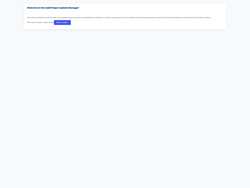
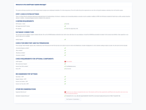
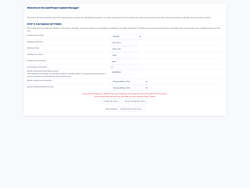
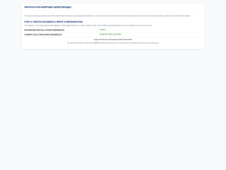
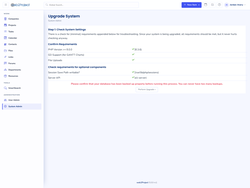

Installing web2project is the same as installing any other PHP project and has minimal requirements. The definitive version of this [Installation Guide](https://docs.web2project.net/docs/installation.html) is available online but this section should be the same.

**Requirements:**

These requirements have been tested and validated. Web2project may work with other versions or systems but they are not formally supported. These requirements apply regardless of whether you're installing, upgrading, or converting.

* PHP 8.3+ with the `ctype`, `filter`, `gd`, `json`, `mysqli` and `session` extensions (and `mbstring` or `iconv`)
* MySQL 8.x+ or MariaDB 10.x+
* Apache 2.4+ or nginx, or IIS 7.x+
* [Composer](https://getcomposer.org/)

More detail on each of these is in [Server and Database Configuration](/docs/server-configuration.html).

## Install Instructions

   

1. Download the latest release from [GitHub](https://github.com/web2project/web2project/releases) and uncompress it.
1. Upload the resulting folder to a web-accessible directory on your web server. Note the resulting URL as this will be your new web2project installation.
1. Create a MySQL database and a user with full access to the database. Save these database name and credentials as you will need them later.
1. From the command line within the web2project folder, run `composer install --no-dev` or the equivalent for your system.
1. Point your browser to the URL noted above.
1. The Installer should detect that you are creating a fresh installation.
1. Confirm that your web server meets the minimum requirements. The first step lists the PHP version, file uploads, each PHP extension (marked required or optional, with what it's used for) and the folders that need to be writable. If anything required fails, resolve it and reload the page. If it passes, continue.
1. Use the database name and credentials from above to configure the database connection.
1. Select "Install Db & Write Cfg." The system should create all database tables and configure the base system.
1. If the Installer could not create the `config.php` file, copy and paste it to create your own.
1. Log into your system with the provided username and password.
1. Change your username and password.
1. Block direct web access to the `files` folder, as described in [Server and Database Configuration](/docs/server-configuration.html#files-and-folders).
1. Proceed to [Getting Started](/docs/getting-started.html) or the [Frequently Asked Questions](/docs/faq.html) as you need.
1. Add a cron job to run system maintenance tasks such as sending email notices and task reminders. The easiest approach is to request the URL below via a cron job:

> `wget -O - -q http://{web2project-install}/queuescanner.php`

 Uploaded files are stored in the `files` folder inside the web root, protected only by an Apache 2.2-style `.htaccess` file. On Apache 2.4 or nginx, add the rule from [Server and Database Configuration](/docs/server-configuration.html#files-and-folders) or anyone can download them without logging in. See [Security Notes](/docs/security-notes.html).

 If you run into any problems, we recommend that you resolve the issue and then delete `config.php` and drop the database tables to try again.

## Upgrade Instructions

1. Back up your database and `files` folder. You can never have too many backups.
2. Download the latest release from [GitHub](https://github.com/web2project/web2project/releases) and uncompress it.
3. Upload the resulting folder to your web server.
4. Copy your `files` folder from your previous folder to the new one.
5. Copy your `includes/config.php` file from your previous folder to the new one.
6. From the command line within the new folder, run `composer install --no-dev`.
7. Rename the old folder.
8. Rename the new folder to the old folder's previous name.
9. Point your web browser to your web2project folder.
10. Log in with an Administrator account.
11. Select the System Admin module and choose "Apply System Updates"
12. The Installer will handle applying all updates. It lists any errors it hits; a clean upgrade reports none.
13. Use your system as normal.

## Upgrading to v5.0

v5.0 is a major release. Read this before you upgrade an existing system.

* **Back up first.** v5.0 adds database migrations 063–078. They change permissions, contacts, custom fields, the access log, the history and the Resources tables, and clean up data that older versions stored: apostrophes saved as `&#039;` (075), zero dates in the login log (076) and project colours that aren't six-digit hex codes (078). *Apply System Updates* runs them all, and stops at the first statement that fails with the full error. Once you've fixed the cause, run it again.
* **Login names must be unique.** Migration 077 adds a unique index on login names, compared without regard to case. Where two or more users share a login name, the oldest account keeps it and the others are renamed to `<name>-<user id>` (for example `jsmith-42`). Each rename is recorded in the History module. Tell those users their new login name.
* **Module access is enforced.** A module's pages and forms now open only when the module is active and the user has Access to it. Users who reached a module by its URL without that permission are now refused, so check your roles if someone loses a page they need.
* **One theme.** The interface is now Bootstrap 5.3 only. The w2p-snowball and wps-redmond themes, theme selection and the per-user "User Interface Style" preference are gone, so a custom theme folder will no longer load. Template overrides go in `style/bootstrap/`.
* **Removed features.** PDF output (reports, Gantt charts and forums; use your browser's *Print → Save as PDF*), file check-in/check-out, file versions and file e-mail notifications.
* **Add On modules.** v5.0 removes long-deprecated functions and class names. Modules that still use them will stop with errors. Check each module against [Updating Add On Modules for v5.0](/docs/upgrading-modules-to-5.html) before upgrading, and disable any that aren't updated.
* **Resources module.** Migration 068 fixes the Resources tables on systems where adding a resource failed. If you use it, turn it on under System Admin → View Modules.
* **Database server.** MySQL 8's default `sql_mode` now works without changes.
* **Translations.** Translation (`.inc`) files are now read as data, not run as PHP. Custom translation files that contain anything other than quoted strings will lose those entries; see [Translation Management](/docs/translation-management.html).

The [v5.0 release notes](/release-notes/5.0.0-rc1.html) list every change.

## Convert from dotProject

1. Back up your database, the `files` folder, and `includes/config.php`. You can never have too many backups.
2. Download the latest release from [GitHub](https://github.com/web2project/web2project/releases) and uncompress it.
3. Upload the resulting folder to your web server. Note the resulting URL as this will be your new web2project installation.
4. From the command line within the web2project folder, run `composer install --no-dev`.
5. Copy your `files` folder from your dotProject folder to your web2project folder.
6. Copy your `includes/config.php` file from your dotProject folder to your web2project folder.
7. Point your browser to your web2project folder.
8. The Installer will detect the dotProject configuration and apply database updates, data transformations, and update the `config.php`. *This may take a while depending on how big your database is.*
9. Log into your system with your existing username and password.
10. Add a cron job to run system maintenance tasks such as sending email notices, etc. The easiest approach is to request the URL below via a cron job:

> `wget -O - -q http://{web2project-install}/queuescanner.php`

 If you run into any problems, we recommend that you overwrite your new `config.php` with the dotProject version and restore the dotProject database. Then resolve the issue and try again.
