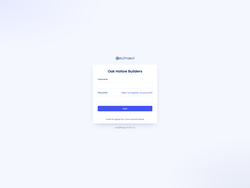
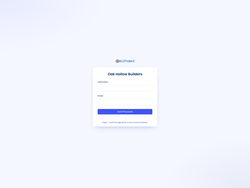
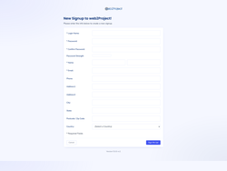

### Overview

Here you will find discussion regarding a few screens within web2project that do not relate specifically to one module.

### Login

The first page that a user, or prospective user, sees when they access the system. This screen has three functions: (1) log in to the system, (2) request a new password if the existing one has been misplaced, and (3) let a potential new user request login credentials.

### Forgotten Password

Use this screen to reset your password and regain access to the system.

### New Account Request

This screen may be used for the obvious purpose of requesting login credentials from the system administrator. It is presumed that the person using this screen was directed to it by someone within their project's hierarchy: we do not expect people casually browsing the net to come upon this screen and request access.