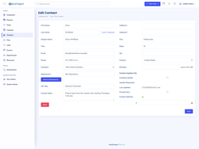
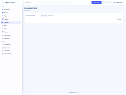
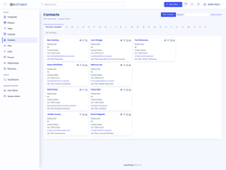

## Module Overview

The contacts module is a place to store information about users and additional contacts. Every user has a contact record, created along with the user, but not all contacts need to be users.

Select Contacts in the sidebar to open the module. Contacts are also attached to companies, departments, projects and tasks, and appear on their pages.

### Creating a Contact (Contact Add/Edit Page)

Creating your first contact is simple. Choose "New Contact" from the "New Item" menu, or select Contacts in the sidebar and then the "New contact" button. A contact doesn't need a login; it is simply an entry in the shared address book.

The form has these fields:

* **First Name**, **Last Name** and **Display Name**, with a "use in display" option to build the display name from the first and last names
* **Title** and **Job Title**
* **Company** and **Department**
* **Address1**, **Address2**, **City**, **State**, **Zip** and **Country**
* **Birthday**, in yyyy-mm-dd format
* **Email** and **Phone**. No two contacts can have the same email address.
* **Contact Methods**: any number of extra phone numbers, e-mail addresses, web addresses and instant messenger accounts. The available methods are the *ContactMethods* lookup values in System Admin.
* **Contact Notes**
* **Private Entry**, to hide the contact from everyone but you

To create a login for an existing contact, open the contact and select "create user".

#### Importing a vCard

If someone has sent you a vCard – normally attached to an email or available from their website – select "Import vCard" on the Contacts list and upload the `.vcf` file. One file can hold several contacts. Web2project fills in the name, title, birthday, e-mail, phone numbers, address and notes. It doesn't match the vCard's organization to a company; the organization name is added to the end of Address2, so edit the contact afterwards and choose its Company.

Each contact also has an "export vCard" icon on the list, to download that contact as a `.vcf` file.

### Attach Contacts to Projects / Tasks

Reporting and information sharing with external project stakeholders is absolutely required for successful project management. To facilitate this, web2project lets you attach Contacts to specific projects, on the project form, or to individual Tasks, on the task form's Details tab. When someone logs time on a task, they can tick *Email Task Contacts* or *Email Project Contacts* to send the update to those people. Which boxes start ticked is set by each user's *Task Log Email Defaults* preference, with the default for new users set in System Admin → Default User Preferences.

### View your Contact List (Contact Index Page)

The Contacts list shows each contact as a card with their name, company, job title, department, address, phone and e-mail address. The tabs across the top are "Recently Updated", one tab per letter A to Z, and "All Contacts".

From this page you can:

1. Search for contacts with the Search box, and "Reset search" to clear it.
1. Add a contact with "New contact".
1. Download all contacts as a CSV file with "CSV Download".
1. Import contacts from a vCard with "Import vCard".
1. Use the icons on each card to edit the contact, export it as a vCard, see the projects it is attached to, or open its user account if it has one.
1. Click a contact's name to open their page.

The contact's page shows all their details and contact methods. The links at the top lead back to the list and let you edit or delete the contact, or view the user account if there is one. A contact that belongs to a user can't be deleted.

*Up to v4, a contact could be e-mailed a private link to fill in their own details (**Awaiting Update**). The feature was removed in v5.0.*
