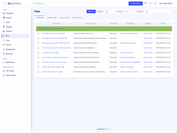
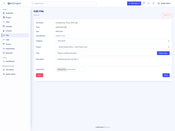

## Module Overview

Once your project begins, you will likely want to attach files to it: contracts, requirements, technical specifications, relevant standards, or any of a plethora of other things. While these can be handled in a third-party Document Management System or a wiki, it is often better to have a single location for pulling all this information together into a single interface for review, comment, update, or perusal.

The Files module stores files and associates them with [Companies](/modules/companies.html), [Projects](/modules/projects.html) and [Tasks](/modules/tasks.html). It appears in the main navigation by default, and the same list is shown on the Files tab of each company, project and task.

In the Files module you can:

* Upload files in any format
* Put each file in a category
* Attach files to a project or a task
* Organise files into folders and subfolders
* Filter the list by project, owner and category
* See who uploaded each file and when

 v5.0 removed file check-in/check-out, file versions and the e-mail notification sent when a file was added. Existing files keep their data; the latest version of each file is the one shown.

### Attach a File

There are three ways to get to the upload form and they are all effectively the same. The fastest is to select "New File" from the "New Item" menu at the top of any page. Alternatively, you can select Files from the main navigation and then click on the "New File" button. Finally, you can open a particular project or task, select its Files tab, and add the file from there.

### Files List (Files Index)

When you select "Files" from the main navigation you will see the Files list.

At the top of the page are the "New File" and "New Folder" buttons and three filters:

* **Project** shows only the files attached to that project.
* **Owner** shows only the files uploaded by that user.
* **Category** jumps to that category's tab.

Below them is a row of tabs: "All Files", one tab per file category, each with the number of files it holds, and a Folders tab at the end (see Folders below). The counts follow the Project and Owner filters, so you can combine a project with a category. You can define the categories to meet your own needs in System Admin under the *FileType* lookup values.

The files are listed under a heading for the project they belong to. You only see files from the projects and tasks you are allowed to see.

By default the list has these columns:

* An edit icon, to change the file's details or upload a replacement
* **File Name**: click it to download the file
* **Description**
* **Category**
* **Task Name**: the task the file is attached to, if any
* **Owner**: the user who uploaded it
* **Date**: when it was uploaded

Long lists are split into pages, and the page links keep your current project, company or task.

Downloads go through `fileviewer.php`, which checks that you are logged in and allowed to see the file. See [Security Notes](/docs/security-notes.html) for how to make sure files can't be downloaded any other way.

### Add or Edit a File (Files addedit)

The form has these fields:

* **File Name, Type, Size and Uploaded By** are shown when you edit an existing file. They come from the uploaded file and can't be changed here.
* **Category** puts the file under one of the category tabs on the Files list.
* **Project** attaches the file to a project. Adding the file from a project's or task's Files tab fills this in for you.
* **Folder** puts the file in a folder, or in Root for none. Adding a file from a folder fills this in for you. Choose another folder to move the file.
* **Task** attaches the file to one of that project's tasks. Use the "select task..." button to pick it.
* **Description** lets you add notes about the file.
* **Upload File** lets you choose the file on your computer. When you edit a file, choosing a new one replaces the file attached to this entry. Changing the project moves the stored file to the new project's folder.

### Folders

Folders let you organise files in a tree of your own, alongside projects and categories. A folder isn't tied to a project, so one folder can hold files from several projects.

The **Folders** tab, the last tab on the Files list, shows the folder tree starting at Root:

* The current folder's name and description are shown at the top, with its files listed underneath. The home and back icons return to Root or to the parent folder.
* Each subfolder shows how many files it holds. Click the count to show or hide those files, or click the folder's name to open it.
* Beside each folder are icons to add a subfolder, add a new file to that folder, edit the folder, and delete it.

The "New Folder" button, and the edit icon on a folder, open the folder form:

* **Subfolder of** sets where the folder sits in the tree. Choose Root for a top-level folder. A folder can't be moved into itself or into one of its own subfolders.
* **Folder Name**
* **Description**

A folder can only be deleted once it has no subfolders and no files. Move or delete its contents first.

Folders have no permissions of their own. Everyone who can see the Files module sees every folder, but inside a folder you still only see files from the projects and tasks you are allowed to see. Creating and editing folders uses the Files module's Add and Edit permissions.

The Files tabs on companies, projects and tasks show a plain list, without folders.
