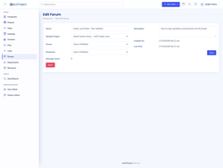
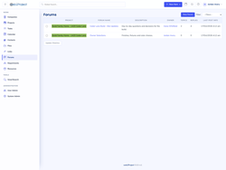
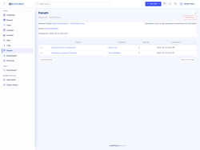
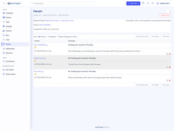

## Module Overview

One of the simple ways to improve tracking of your Project is to ensure that all relevant discussion, communications, etc are attached to the Project. To make this process easier, web2project has a simple threaded forum system built-in. It is not as advanced or flexible as some systems such as phpBB or vBulletin but since it is part of web2project, it will automatically have the same look and feel in addition to all the security and permissions benefits.

The Forum Module in web2project is an optional added feature designed specifically to help improve communication and collaboration.

 The Forums module is installed but turned off by default. To use it, go to System Admin → View Modules, activate Forums and set it to “visible” so it appears in the sidebar.

### Create or Edit a Forum (Forums Addedit)

To add a new forum select “Forums” in the sidebar, then the “New Forum” button.

The Add Forum page contains a simple form that you can use to create a new forum.

From this page you can:

* Give the forum a unique **Name**
* Assign this forum to a **Related Project**
* Assign an **Owner** to this forum
* Assign a **Moderator** to this forum
* Enter a brief **Description**
* Go back to the forums list page

When you edit an existing forum, the form also shows when it was created, its message count and its last post. To delete a forum, open it and use the “delete forum” link at the top of the page.

### List all Forums (Forums Index)

The forums list page shows all the available forums in web2project. From this page you can:

* View available forums
* Edit a forum
* See if a forum has unread topics
* Choose to watch a forum for updates, then select “update watches”
* Click on a forum name to enter that forum
* View who created the forum
* View how many topics and replies are in the forum
* View the time and date of the last post.

### Forum / Thread Watch

 

The most important aspect of the entire Forum module is the ability to set “Watches”. When an individual sets a watch on a thread or an entire forum, web2project will automatically notify them each and every time there is a new comment. This ensures that the relevant information gets to the interested people as fast as possible with minimal effort. An administrator can also make everyone watch new forums with the module's “configure” link under System Admin → View Modules.

Forums attached to a project also appear on that project's Forums tab.

 v5.0 removed the PDF export of forum messages. To keep a copy of a thread, use your browser's *Print → Save as PDF*.
